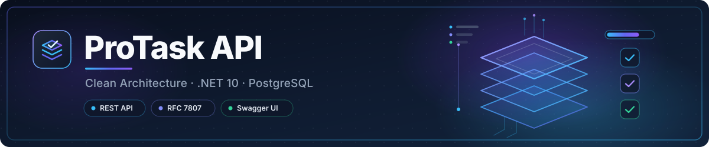

<p align="center">
  
</p>

<p align="center">
  
  
  
  
  
</p>

API REST para la gestión de proyectos y sus respectivas tareas, construida bajo Clean Architecture en **.NET 10** con **PostgreSQL** (Entity Framework Core / Npgsql).

## Objetivo

Desarrollar una API REST que permita gestionar proyectos y sus respectivas tareas, garantizando validaciones de negocio, manejo consistente de excepciones bajo RFC 7807, persistencia relacional en PostgreSQL, documentación interactiva con OpenAPI/Swagger, pruebas automatizadas y preparación para despliegue automatizado en Azure mediante CI/CD.

---

## Modelo de Datos y Entidades

### Relación

- **1:N (Uno a Muchos):** Un proyecto puede tener muchas tareas, pero una tarea solo puede pertenecer a un proyecto.

### Proyecto (`Project`)

| Campo | Tipo | Descripción |
| :--- | :--- | :--- |
| `Id` | `int` | Identificador único del proyecto |
| `Name` | `string` (máx. 150) | Nombre del proyecto (obligatorio) |
| `Description` | `string?` (máx. 1000) | Descripción detallada del proyecto |
| `StartDate` | `DateTime` (UTC) | Fecha de inicio del proyecto |
| `EndDate` | `DateTime` (UTC) | Fecha de finalización (`EndDate >= StartDate`) |
| `TotalTasks` *(DTO)* | `int` | Total de tareas asociadas al proyecto |
| `CompletedTasks` *(DTO)* | `int` | Cantidad de tareas en estado `Completada` |
| `ProgressPercentage` *(DTO)* | `double` | Porcentaje de avance (`0` a `100`, redondeado a 2 decimales) |

### Tarea (`TaskItem`)

| Campo | Tipo | Descripción |
| :--- | :--- | :--- |
| `Id` | `int` | Identificador único de la tarea |
| `Title` | `string` (máx. 200) | Título de la tarea (obligatorio) |
| `Description` | `string?` (máx. 2000) | Descripción de la tarea |
| `Status` | `TaskItemStatus` | Estado actual: `Pendiente`, `EnProgreso`, `Completada` |
| `Priority` | `TaskPriority` | Prioridad: `Baja`, `Media`, `Alta`, `Critica` |
| `DueDate` | `DateTime` (UTC) | Fecha límite de entrega |
| `ProjectId` | `int` | Identificador del proyecto al que pertenece (clave foránea) |
| `IsOverdue` *(DTO)* | `bool` | Indica si `DueDate < UtcNow` y `Status != Completada` |

---

## Endpoints de la API

### Proyectos (`/api/projects`)

| Método | Ruta | Descripción | Respuestas |
| :--- | :--- | :--- | :--- |
| `GET` | `/api/projects` | Listar todos los proyectos con `%` de avance | `200` |
| `GET` | `/api/projects/{id}` | Obtener un proyecto por ID con `%` de avance | `200`, `404` |
| `GET` | `/api/projects/{id}/tasks` | Consultar todas las tareas de un proyecto | `200`, `404` |
| `POST` | `/api/projects` | Crear un nuevo proyecto | `201`, `400` |
| `PUT` | `/api/projects/{id}` | Actualizar un proyecto existente | `200`, `400`, `404` |
| `DELETE` | `/api/projects/{id}` | Eliminar un proyecto (bloqueado si tiene tareas `Pendiente` o `EnProgreso`) | `204`, `404`, `409` |

### Tareas (`/api/tasks`)

| Método | Ruta | Descripción | Respuestas |
| :--- | :--- | :--- | :--- |
| `GET` | `/api/tasks` | Listar tareas con filtros opcionales `?status=...&priority=...` | `200`, `400` |
| `GET` | `/api/tasks/overdue` | Listar tareas vencidas no completadas | `200` |
| `GET` | `/api/tasks/{id}` | Obtener una tarea por ID | `200`, `404` |
| `POST` | `/api/tasks` | Crear una nueva tarea asociada a un proyecto existente | `201`, `400`, `404` |
| `PUT` | `/api/tasks/{id}` | Actualizar una tarea existente | `200`, `400`, `404` |
| `PATCH` | `/api/tasks/{id}/status` | Cambiar únicamente el estado de una tarea | `200`, `400`, `404` |
| `DELETE` | `/api/tasks/{id}` | Eliminar una tarea | `204`, `404` |

### Diagnóstico y Documentación

- **Health check (PostgreSQL + JSON detallado):** `GET /health`
- **Liveness probe (ligero, sin BD):** `GET /health/live`
- **Especificación OpenAPI (enums en texto):** `GET /openapi/v1.json`
- **Swagger UI:** `GET /swagger`

Ejemplo de respuesta de `GET /health`:

```json
{
  "status": "Healthy",
  "totalDurationMs": 12.45,
  "checks": [
    {
      "name": "postgresql",
      "status": "Healthy",
      "description": "Conexión exitosa a PostgreSQL.",
      "durationMs": 11.82
    }
  ]
}
```

---

## Requerimientos Funcionales

- [x] **CRUD de proyectos y tareas:** Crear, consultar, actualizar y eliminar proyectos y tareas.
- [x] **Consultar tareas por proyecto:** Obtener todas las tareas asociadas a un proyecto específico (`GET /api/projects/{id}/tasks`).
- [x] **Filtrar tareas:** Filtrar tareas por **estado** y/o **prioridad** (`GET /api/tasks?status=&priority=`).
- [x] **Consultar tareas vencidas:** Listar tareas cuya fecha límite haya pasado y que aún no estén completadas (`GET /api/tasks/overdue`).
- [x] **Cambiar el estado de una tarea:** Actualizar el estado de una tarea (`PATCH /api/tasks/{id}/status`).
- [x] **Cálculo de porcentaje de avance:** Calcular el porcentaje de avance de un proyecto con base en sus tareas completadas sobre el total de tareas (`0%` si no tiene tareas).
- [x] **Protección de eliminación:** Impedir la eliminación de proyectos que tengan tareas `Pendiente` o `EnProgreso` (`409 Conflict`).
- [x] **Validaciones y manejo de excepciones:** Validaciones con FluentValidation y middleware global respondiendo bajo **RFC 7807 (`application/problem+json`)** con `traceId`.

---

## Requerimientos Técnicos

- [x] **Base de datos relacional:** Persistencia configurada con **PostgreSQL** (`Npgsql.EntityFrameworkCore.PostgreSQL`), Entity Framework Core 10 y migración inicial `InitialCreate`.
- [x] **Documentación con Swagger:** OpenAPI (`/openapi/v1.json`) e interfaz interactiva de Swagger UI (`/swagger`).
- [x] **Control de versiones en GitHub:** Repositorio configurado con historial de commits y `.gitignore` para `.NET`.
- [x] **Pruebas automatizadas:** 96 pruebas organizadas en espejo 1 a 1 con `src/` (`Category=Unit` y `Category=Integration`):
  - `ProTask.Domain.Tests` (**15 pruebas** unitarias puras de entidades).
  - `ProTask.Application.Tests` (**44 pruebas** unitarias de servicios, validadores y mapeos).
  - `ProTask.Infrastructure.Tests` (**15 pruebas**: 2 DI + 13 de integración contra PostgreSQL real en `protask_infra_test`).
  - `ProTask.API.Tests` (**22 pruebas**: 11 unitarias de controladores + 11 de integración HTTP contra PostgreSQL real en `protask_api_test`).
- [ ] **Despliegue en Azure:** Publicación de la API (Azure App Service) y base de datos PostgreSQL en Microsoft Azure *(pendiente para fase posterior)*.
- [ ] **CI/CD con GitHub Actions:** Pipeline automatizado (`dotnet build`, `dotnet test` y despliegue automático) *(pendiente para fase posterior)*.

---

## Estructura de la Solución

```text
ProTask/
├── ProTask.slnx
├── README.md
├── PLAN_IMPLEMENTACION.md
├── docs/
│   └── assets/
│       └── protask-banner.svg    # Banner vectorial del README
├── src/
│   ├── ProTask.Domain/           # Entidades, enums, excepciones e interfaces de dominio (0 paquetes externos)
│   ├── ProTask.Application/      # DTOs, validadores FluentValidation, mapeo manual y servicios
│   ├── ProTask.Infrastructure/   # DbContext, configuraciones Fluent API, migraciones PostgreSQL y repositorios
│   └── ProTask.API/              # Controladores, middleware RFC 7807, health checks, OpenAPI/Swagger y Program.cs
└── tests/
    ├── ProTask.Domain.Tests/         # Pruebas unitarias de ProTask.Domain (Entities)
    ├── ProTask.Application.Tests/    # Pruebas unitarias de ProTask.Application (Services, Validators, Mappings)
    ├── ProTask.Infrastructure.Tests/ # Pruebas de integración PostgreSQL (Data, Repositories, DI)
    └── ProTask.API.Tests/            # Pruebas de controladores (Unit) + endpoints HTTP / OpenAPI (Integration)
```

---

## Ejecución Local y Pruebas

### 1. Configurar PostgreSQL local (sin guardar contraseñas en Git)

```bash
dotnet user-secrets init --project src/ProTask.API
dotnet user-secrets set "ConnectionStrings:DefaultConnection" "Host=localhost;Port=5432;Database=protask_dev;Username=postgres;Password=TU_PASSWORD" --project src/ProTask.API
```

### 2. Aplicar la migración inicial

```bash
dotnet ef database update --project src/ProTask.Infrastructure --startup-project src/ProTask.API
```

### 3. Compilar, probar y ejecutar la API

```bash
dotnet build ProTask.slnx --configuration Release
dotnet run --project src/ProTask.API
```

Swagger UI quedará disponible en `http://localhost:5184/swagger`.

---

## Pruebas Automatizadas (Unitarias vs. Integración)

Cada proyecto en `tests/` espeja 1 a 1 su capa equivalente en `src/` y cada clase lleva el atributo `[Trait("Category", "Unit")]` o `[Trait("Category", "Integration")]`:

| Proyecto | Carpetas / Archivos | Categoría | Casos | Base de datos |
| :--- | :--- | :---: | :---: | :--- |
| `ProTask.Domain.Tests` | `Entities/` | `Unit` | 15 | No |
| `ProTask.Application.Tests` | `Services/`, `Validators/`, `Mappings/` | `Unit` | 44 | No (`Moq`) |
| `ProTask.Infrastructure.Tests` | `DependencyInjectionTests.cs` | `Unit` | 2 | No |
| `ProTask.Infrastructure.Tests` | `Data/`, `Repositories/` | `Integration` | 13 | PostgreSQL (`protask_infra_test`) |
| `ProTask.API.Tests` | `Controllers/` | `Unit` | 11 | No (`Moq`) |
| `ProTask.API.Tests` | `Endpoints/` | `Integration` | 11 | PostgreSQL (`protask_api_test`) |

- **Total:** **96 casos** (**72 `Unit`** + **24 `Integration`**).
- Las pruebas de integración toman automáticamente la conexión desde `PROTASK_TEST_CONNECTION` (o tus `user-secrets` de `ProTask.API`) y siempre apuntan a bases terminadas en `_test`, protegiendo `protask_dev`.

### Comandos para ejecutarlas

```bash
# Solo pruebas unitarias (rápidas, sin PostgreSQL)
dotnet test ProTask.slnx --configuration Release --no-build --filter Category=Unit

# Solo pruebas de integración (contra PostgreSQL real)
dotnet test ProTask.slnx --configuration Release --no-build --filter Category=Integration

# Por proyecto específico
dotnet test tests/ProTask.Domain.Tests
dotnet test tests/ProTask.Application.Tests
dotnet test tests/ProTask.Infrastructure.Tests
dotnet test tests/ProTask.API.Tests

# Todas las pruebas en paralelo
dotnet test ProTask.slnx --configuration Release --no-build
```

> En **JetBrains Rider**, puedes abrir la ventana **Unit Tests** y activar **Group by → Categories** para ver separadas visualmente las carpetas `Unit` e `Integration`.

---

## Entregables

- **Repositorio de GitHub:** https://github.com/jose2520/ProTask
- **URL de la API desplegada (Azure):** _Pendiente por desplegar en Azure_
- **Documentación Swagger (Azure):** _Pendiente por desplegar en Azure_
- **Evidencia del pipeline CI/CD (GitHub Actions):** _Pendiente por configurar y ejecutar pipeline_
